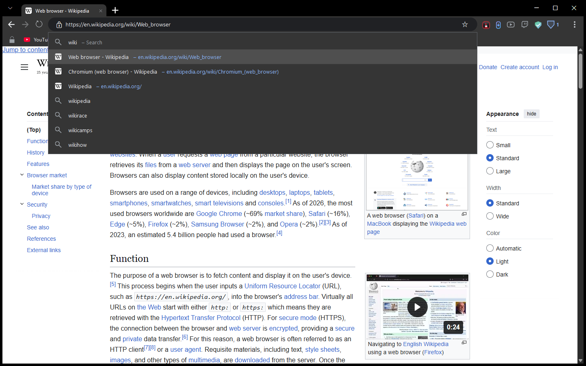
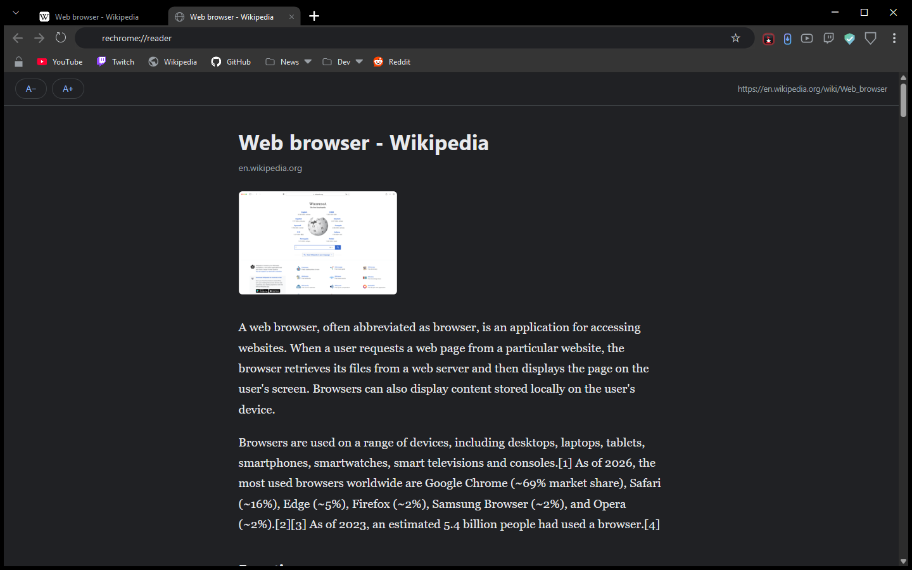
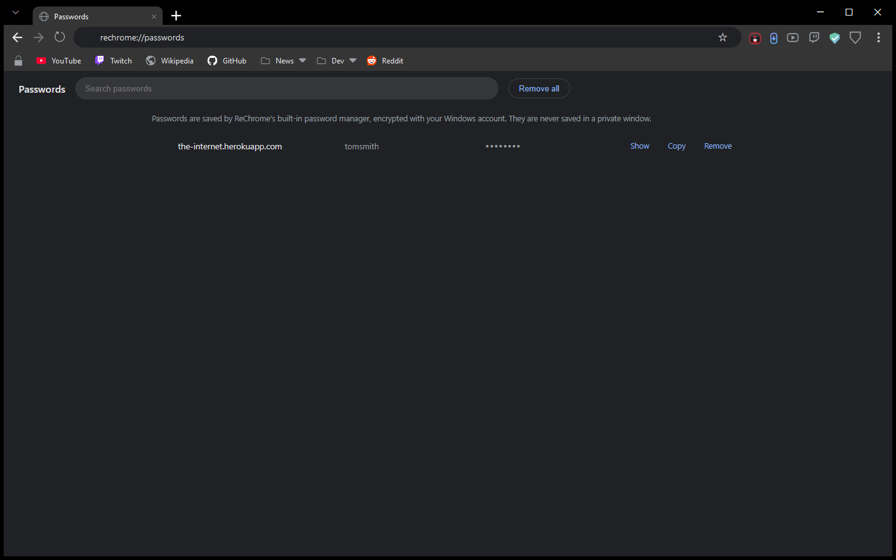
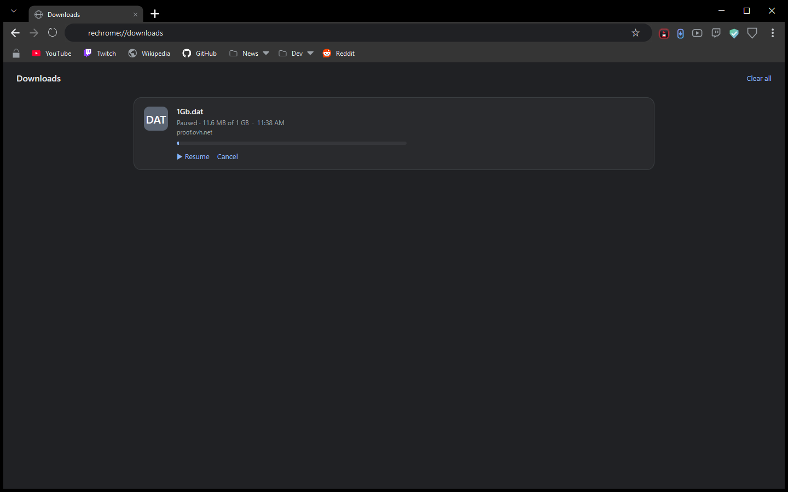
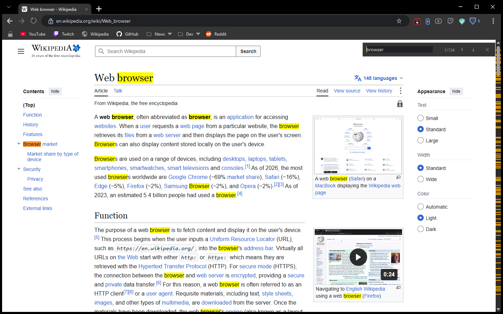
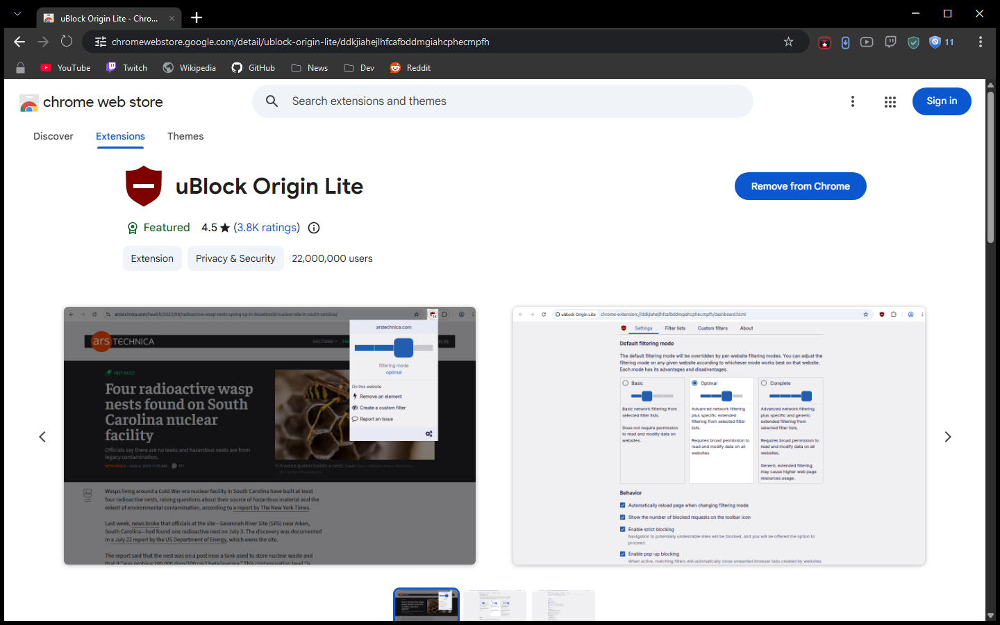
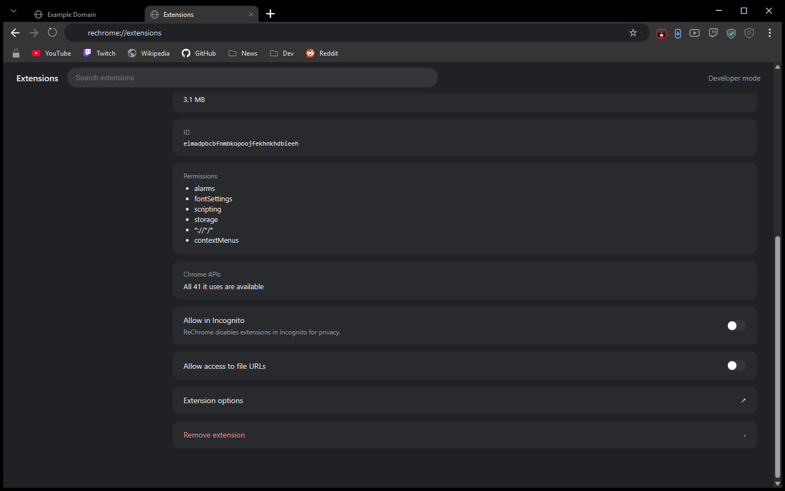

# ReChrome

A portable Windows browser built on the Chromium engine, with a built-in ad
blocker that goes further than an extension can — including **server-stitched
Twitch ads**, the kind spliced into the video stream itself where a normal
blocker has nothing to block.

**[⬇ Download the latest release](../../releases/latest)** · one `.exe`, no
installer, no admin rights, nothing else to install.


It looks and works like Chrome: tabs at the very top, an omnibox, a bookmarks
bar with real favicons, Chrome's own icons and menus. It keeps everything in a
`VeilData` folder beside the exe, so it runs from a USB stick and leaves nothing
behind when you delete the folder.

---

## At a glance

| | |
|---|---|
| **Engine** | Chromium, via Microsoft WebView2 (the engine inside Edge) |
| **Ad blocking** | Built in, no extension: 20 filter lists (uBlock Origin's, EasyList, EasyPrivacy and more), ~326,000 network rules and ~42,000 element-hiding rules, plus dedicated YouTube and Twitch layers |
| **Install** | None. A single portable `ReChrome.exe` |
| **Platform** | Windows 11 (Windows 10 with the WebView2 runtime) |
| **Extensions** | Chrome Web Store extensions install with **Add to Chrome**, and AI assistants (Claude, ChatGPT, Cursor) can drive the browser as they do in Chrome. See [AI assistants](#ai-assistants-in-the-browser) |
| **Telemetry** | None. Every outbound call it makes on its own is listed [below](#what-it-talks-to) |
| **Updates** | Only when you ask. Downloads are checked against a published SHA-256 |

---

## Screenshots

### Built-in ad and tracker blocking
The Shield page: on/off, live counts, and every filter list with its rule
count. No extension needed, and it keeps working on sites that fight
extensions.


### Address bar that knows where you're going
Start typing and ReChrome finishes the address from your history and
bookmarks (`you` becomes `youtube.com`), lists matching pages and open tabs,
and adds your search engine's suggestions. Arrow keys to pick, Enter to go.



### Reader mode
`Ctrl+Alt+R` strips a page down to the article: clean text in a comfortable
column, with the pictures kept and everything else gone. Bigger or smaller
text with one click.



### Passwords, downloads and find, done properly

| Saved passwords | Downloads you can pause | Find in page |
|---|---|---|
|  |  |  |

See, copy or remove the passwords ReChrome has saved; pause, resume or cancel
a download; and find in page with a live "3 of 17" count, every match
highlighted.

### Chrome's look, Chrome's settings layout
Settings follows Chrome's own layout, wired to ReChrome's features. From here
you can also make ReChrome your default browser, so links from other apps
open in it.


### Extensions, straight from the Chrome Web Store
Open any extension on the Chrome Web Store and click **Add to Chrome**: ReChrome
asks first, as Chrome does, listing what the extension will be able to do, then
installs it. **Remove from Chrome** works from the store page too, and an
extension you remove stays removed. You can also paste a store link, import the
extensions you already have in Chrome, or load one from a folder or
`.crx`/`.zip`.



Each extension's Details page shows whether every Chrome feature it uses is
available here, checked automatically when the extension starts. The built-in
tools (Video Grabber, AutoScroll, Shield) are listed on the Extensions page too,
each with its own on/off switch.



### AI assistants in the browser
The Claude and ChatGPT extensions, and Cursor through Browser MCP, work the way
they do in Chrome. They can open, switch, move, pin and group tabs, read and
click pages, take screenshots, and open ReChrome's own pages
(`chrome://settings` opens ReChrome's Settings). What they do happens on
ReChrome's tab strip in front of you. Their side panels open beside the page,
keyboard shortcuts work, and dictation in a side panel asks for the microphone
first.

An assistant sees your bookmarks, history and most-visited sites only if its
extension asked for that permission, as in Chrome, and only it can change them.
A desktop app such as Claude Code can drive ReChrome through the Claude
extension: open pages, read console errors and network requests, and take
screenshots.

### Private windows that really leave nothing behind
`Ctrl+Shift+N` opens a private window, marked with a purple accent line.
History, cookies and cache stay in memory only, and the window's profile folder
is deleted when it closes. Private windows also send Do-Not-Track and Global
Privacy Control and use strict tracking prevention.


### Themes
Seven built-in themes (Chrome Dark, Midnight, Carbon, Deep Ocean, Dracula,
Nord, Daylight) and a colour editor for your own. This is Dracula:


### Video Grabber and the new tab page
Download the video or image on the page you're watching: the grabber finds it,
or you click it with **Pick from page**. It uses `yt-dlp` and `ffmpeg`, fetched
once on first use.

| Video Grabber | New tab |
|---|---|
|  |  |

---

## The Twitch ad problem

Most ad blockers work by cancelling network requests. That fails on Twitch,
because the ad is not a separate request — it is cut into the same video
stream as the broadcast, segment by segment. There is no URL to block.

ReChrome reads the stream manifest and removes the ad segments before the
player sees them, then repairs the timeline so playback does not stall.

Measured on real streams, same machine, comparable windows:

| Build | Duration | Ad breaks | Ads that got through |
|---|---|---|---|
| 1.4.0 | 4h 23m | — | **120** |
| 1.5.2 | 4h 22m | 226 | **0** |
| 1.5.3 | 6h 54m | 156 | **0** |

Those numbers come from the browser's own logs over multi-hour sessions on
live channels, not from a test page.

## YouTube and everything else

- **YouTube:** ad data is stripped from the player before it loads, Shorts ads
  are removed from the reel, and feed ads are cut. YouTube's anti-adblock
  responses are handled with the same techniques uBlock Origin uses.
- **Every site:** the filter lists cancel ad, tracker and malware requests, and
  element hiding removes the empty boxes they leave behind (measured on CNN:
  11 visible ad containers → 0).
- **Annoyances:** cookie and consent banners are dismissed (choosing *reject*
  where offered), and "please disable your ad blocker" walls are removed.

**What it does not do:** sponsor reads inside a video, where the streamer or
creator talks about a product. That is the content itself, and no blocker
removes it.

---

## Features

**Browsing**
- Full Chromium engine: H.264, AV1, VP9, WebM, AVIF and Widevine DRM, so
  Netflix- and Spotify-class sites work. HEVC is not offered, because the
  engine cannot decode it; sites then pick a format that plays (this is what
  fixes Twitch's Error #4000)
- Frameless Chrome-style window: drag by the tab strip, double-click to
  maximise, drag a tab out to make a new window
- Pinned tabs, tab groups, tab search (`Ctrl+Shift+A`), mute a single tab
- Session restore after a restart or a crash, plus named tab sets you can save
  and reopen
- Address-bar suggestions from your history, bookmarks and open tabs, with
  inline completion and search suggestions (switch them off in Settings)
- Picture-in-picture, find in page (match count, highlight all), per-site
  zoom, save page as PDF, print
- Screenshots of the visible area or the whole page (`Ctrl+Shift+X`)
- Reader mode (`Ctrl+Alt+R`) and Translate page (Google Translate)
- Reopen a closed window as well as closed tabs (`Ctrl+Shift+T`)
- Profiles: separate work and personal browsing, each with its own
  bookmarks, history, passwords and settings
- Can be your default browser: links and `.html` files from other apps open
  in ReChrome
- Bookmarks bar with folders and real favicons; a bookmark manager
- Downloads you can pause, resume and cancel
- A task manager (`Shift+Esc`) and developer tools (`F12`)

**Privacy and security**
- Private windows keep everything in memory and delete their profile on close
- HTTPS-only mode (optional), secure DNS (optional), clear data on exit
  (optional), a warning before you type a password on an insecure page
- Saved passwords use Chromium's own password manager, encrypted with Windows
  DPAPI; a Passwords page lets you see, copy and remove them; never saved in
  private windows
- Popups show the real site in their title bar, so a fake sign-in popup can't
  pass itself off as Google
- An optional VirusTotal check of a download's hash, with your own API key
  (stored encrypted)
- No telemetry, no crash reporting, no identifiers

**Extensions and AI assistants**
- **Add to Chrome** and **Remove from Chrome** work on the Chrome Web Store
- Extension side panels, toolbar pins with badges, keyboard shortcuts
- Assistant extensions control real tabs, windows, groups and pins, and see
  your bookmarks, history and top sites only with the extension's permission
- Every extension is checked for Chrome features it needs that are missing; the
  result is on its Details page

**Bringing your stuff across**
- Imports bookmarks and history from Chrome, Edge, Brave, Vivaldi and Opera,
  including the Google-account bookmarks modern Chrome keeps in a separate file
- Imports your installed Chrome extensions
- Passwords and cookies are **not** imported. They are encrypted to the source
  browser and cannot be moved reliably

**Built-in tools**
- **Video Grabber:** download the video, image or GIF on a page
- **AutoScroll:** hands-free auto-advance through YouTube Shorts, Facebook and
  Instagram Reels and TikTok, with a switch for each
- **Sleeping tabs:** background tabs sleep after a few idle minutes to free
  memory and wake instantly when clicked
- Touchpad and touchscreen gestures: swipe between pages, pinch to zoom

---

## Honest limitations

- **A few extensions' toolbar popups can't be shown** in WebView2 (some
  Manifest V3 blockers, for example); the extension still runs and its
  settings stay reachable from the Extensions page.
- **Extensions can't read ReChrome's own pages as text** (Settings, Passwords
  and the rest), the same rule Chrome applies to its own pages. An assistant
  can still see them and click on them.
- **A file an extension downloads** is saved to your Downloads folder but is
  not listed on ReChrome's Downloads page yet.
- **AI assistants need their own apps for some things:** ChatGPT's Work mode
  runs through OpenAI's desktop app, Cursor needs Browser MCP's one-time
  **Allow**, and each assistant keeps its own "ask before acting" settings.
- **Passwords and cookies do not import.** They are encrypted to the source
  browser with keys ReChrome cannot read.
- **Windows only.** It is built on WebView2.
- **In-video sponsor reads are not removed.** They are part of the video.
- **No Google account sync.** WebView2 cannot sign in to Chrome sync, so
  bookmarks and passwords do not sync with Chrome on other devices.
- **English only.** The interface is not translated yet.
- **The exe is not code-signed yet,** so Windows SmartScreen may warn the first
  time you run it. Check the SHA-256 below if you want to be sure the file is
  the published one.

---

## Install

1. Download `ReChrome.exe` from [Releases](../../releases/latest).
2. Put it in any folder you like and run it.

Windows 11 already has the WebView2 runtime. On Windows 10 it comes with most
recent Edge versions, or from
[Microsoft](https://developer.microsoft.com/microsoft-edge/webview2/).

To update, open the **⋮** menu and choose **Check for updates…**. The new exe
is downloaded to your Downloads folder and checked against its published
SHA-256; you replace the old file yourself. Your tabs, bookmarks and settings
live in `VeilData` and are not touched.

### Verifying your download

Every release ships the exe and its SHA-256 digest. ReChrome checks the digest
automatically when it updates itself and deletes the file if it does not match.
To check by hand:

```powershell
(Get-FileHash .\ReChrome.exe -Algorithm SHA256).Hash
```

Compare that to the contents of `ReChrome.exe.sha256`.

---

## What it talks to

No analytics, no crash reporting, no identifiers. Besides the pages you visit,
these are the only calls the browser makes on its own:

| Endpoint | Why | When |
|---|---|---|
| `ublockorigin.github.io`, `easylist.to`, `filters.adtidy.org`, `malware-filter.gitlab.io`, `pgl.yoyo.org`, `secure.fanboy.co.nz`, `raw.githubusercontent.com` | Ad, tracker and malware filter lists | Refreshed when a list is old; turn lists off on the Shield page |
| `api.github.com`, `github.com` | Update check and download | Only when you choose **Check for updates** |
| `www.google.com/s2/favicons` | Site icons for bookmarks and tabs | Once per site, then cached; can be turned off in Settings; never from a private window |
| `clients2.google.com` | Installing and updating Web Store extensions | Only when you install or check for updates |
| `github.com` | Fetch `yt-dlp` and `ffmpeg` | The first time you use the Video Grabber |
| `www.virustotal.com` | Look up a download's **hash** (never the file) | Only when you click *Check*, and only with your own API key |
| `dns.google` | Secure DNS | Only if you turn Secure DNS on |
| `suggestqueries.google.com` (or your engine's equivalent) | Search suggestions while you type in the address bar | As you type; switch off in Settings; never from a private window |
| `translate.google.com` | Translate page | Only when you choose **Translate page** |
| `api.pwnedpasswords.com` | Password Checkup: whether a saved password appears in a known breach. Only the first 5 characters of the password's SHA-1 hash are sent, never the password | Only when you run Password Checkup |
| `aus1.torproject.org`, `dist.torproject.org`, `check.torproject.org` | Download and verify Tor, and the Tor window's start page | Only when you open a Tor window |
| `chromewebstore.google.com`, `clients2.google.com` | The store page itself, and the extension package | Only when you click **Add to Chrome** or check for extension updates |

The update check sends no token, no account and no machine identifier, only a
generic `User-Agent`, the same for every copy.

---

## Keyboard shortcuts

| Shortcut | Action |
|---|---|
| `Ctrl+T` / `Ctrl+W` | New tab / close tab |
| `Ctrl+Shift+T` | Reopen the last closed tab (or window) |
| `Ctrl+N` / `Ctrl+Shift+N` | New window / new private window |
| `Ctrl+Shift+W` | Close the window |
| `Ctrl+Tab` / `Ctrl+Shift+Tab` | Next / previous tab |
| `Ctrl+1`–`9` | Jump to tab N |
| `Ctrl+Shift+A` | Search open and recently closed tabs |
| `Ctrl+L` | Focus the address bar |
| `Ctrl+R` / `F5` | Reload |
| `Ctrl+F` | Find in page (Enter / Shift+Enter for next / previous) |
| `Ctrl+D` | Bookmark this page |
| `Ctrl+Shift+B` / `Ctrl+Shift+O` | Toggle bookmarks bar / bookmark manager |
| `Ctrl+H` / `Ctrl+J` | History / downloads |
| `Ctrl+M` | Mute this tab |
| `Ctrl+Shift+P` | Picture-in-picture |
| `Ctrl+P` / `Ctrl+Shift+S` | Print / save as PDF |
| `Ctrl++` / `Ctrl+-` / `Ctrl+0` | Zoom in / out / reset |
| `Ctrl+Shift+Delete` | Clear browsing data |
| `Ctrl+Shift+X` | Screenshot of the visible area |
| `Ctrl+Alt+R` | Reader mode |
| `Shift+Esc` | Task manager |
| `F12` | Developer tools |

---

## About this repository

This repo holds **release downloads only**; the source is private. It exists so
the in-app updater can check for new versions with a plain anonymous HTTPS
request, with no GitHub account and no token on your machine.
