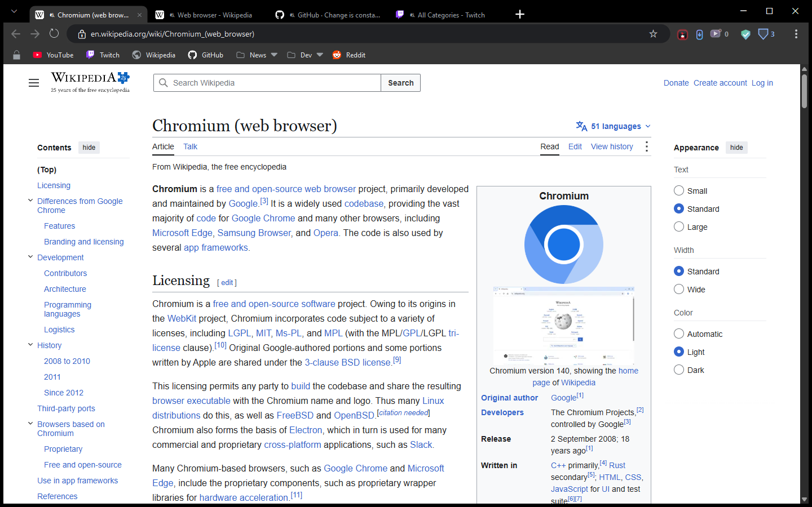
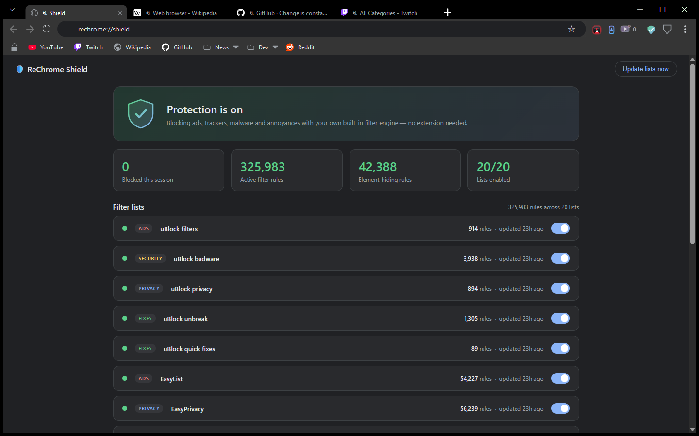
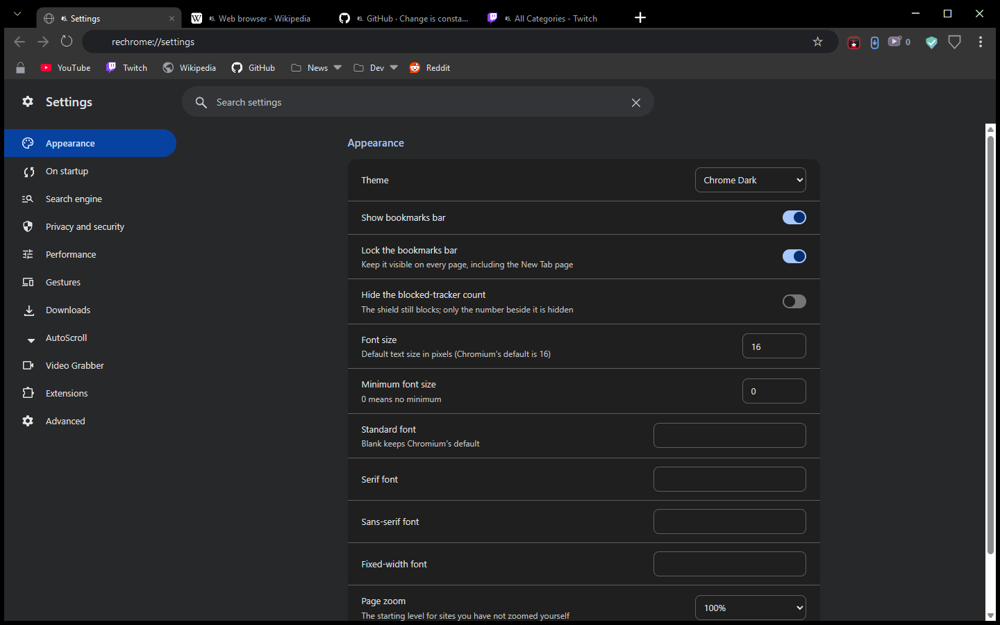
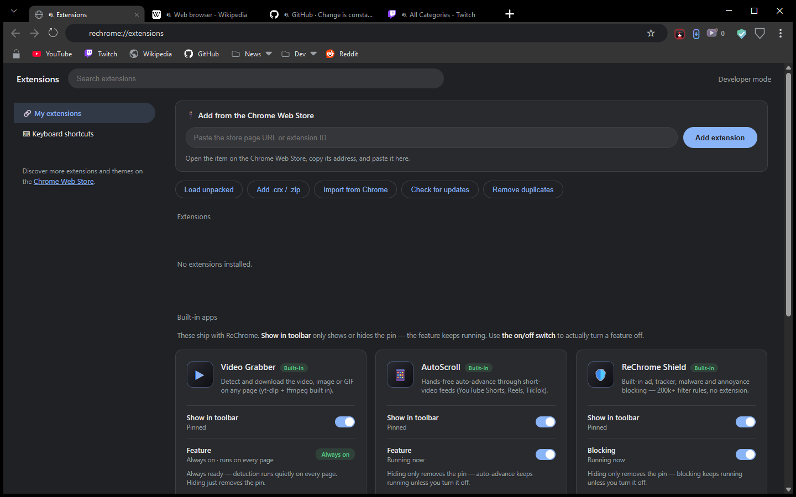
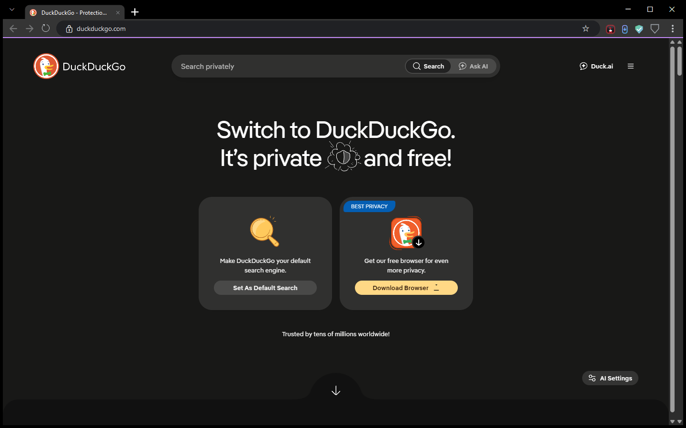
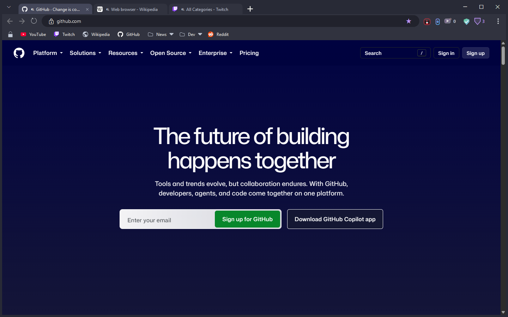
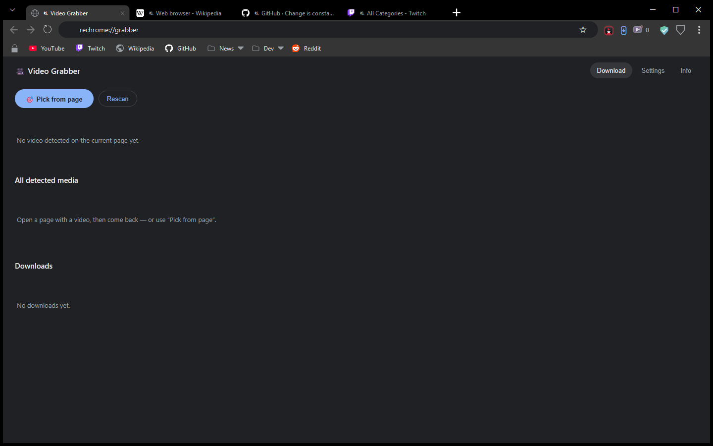
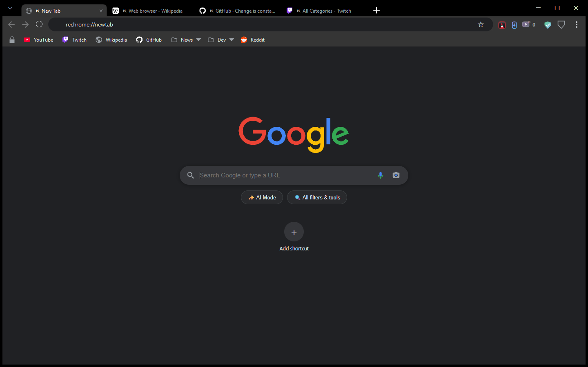

# ReChrome

A portable Windows browser built on the Chromium engine, with a built-in ad
blocker that goes further than an extension can — including **server-stitched
Twitch ads**, the kind spliced into the video stream itself where a normal
blocker has nothing to block.

**[⬇ Download the latest release](../../releases/latest)** · one `.exe`, no
installer, no admin rights, nothing else to install.



It looks and works like Chrome: tabs at the very top, an omnibox, a bookmarks
bar with real favicons, Chrome's own icons and menus. It keeps everything in a
`VeilData` folder beside the exe, so it runs from a USB stick and leaves nothing
behind when you delete the folder.

---

## At a glance

| | |
|---|---|
| **Engine** | Chromium, via Microsoft WebView2 (the engine inside Edge) |
| **Ad blocking** | Built in, no extension: 20 filter lists (uBlock Origin's, EasyList, EasyPrivacy and more), ~326,000 network rules and ~42,000 element-hiding rules, plus dedicated YouTube and Twitch layers |
| **Install** | None. A single portable `ReChrome.exe` |
| **Platform** | Windows 11 (Windows 10 with the WebView2 runtime) |
| **Telemetry** | None. Every outbound call it makes on its own is listed [below](#what-it-talks-to) |
| **Updates** | Only when you ask. Downloads are checked against a published SHA-256 |

---

## Screenshots

### Built-in ad and tracker blocking
The Shield page: on/off, live counts, and every filter list with its rule
count. No extension needed, and it keeps working on sites that fight
extensions.



### Chrome's look, Chrome's settings layout
Settings follows Chrome's own layout, wired to ReChrome's features:
appearance, startup, search engine, privacy, performance, gestures,
downloads, extensions.



### Extensions, including from the Chrome Web Store
Paste a Chrome Web Store link to install an extension, import the ones you
already have in Chrome, or load one from a folder or `.crx`/`.zip`. The
built-in tools (Video Grabber, AutoScroll, Shield) are listed here too, each
with its own on/off switch.



### Private windows that really leave nothing behind
`Ctrl+Shift+N` opens a private window, marked with a purple accent line.
History, cookies and cache stay in memory only, and the window's profile folder
is deleted when it closes. Private windows also send Do-Not-Track and Global
Privacy Control and use strict tracking prevention.



### Themes
Seven built-in themes (Chrome Dark, Midnight, Carbon, Deep Ocean, Dracula,
Nord, Daylight) and a colour editor for your own. This is Dracula:



### Video Grabber and the new tab page
Download the video or image on the page you're watching: the grabber finds it,
or you click it with **Pick from page**. It uses `yt-dlp` and `ffmpeg`, fetched
once on first use.

| Video Grabber | New tab |
|---|---|
|  |  |

---

## The Twitch ad problem

Most ad blockers work by cancelling network requests. That fails on Twitch,
because the ad is not a separate request — it is cut into the same video
stream as the broadcast, segment by segment. There is no URL to block.

ReChrome reads the stream manifest and removes the ad segments before the
player sees them, then repairs the timeline so playback does not stall.

Measured on real streams, same machine, comparable windows:

| Build | Duration | Ad breaks | Ads that got through |
|---|---|---|---|
| 1.4.0 | 4h 23m | — | **120** |
| 1.5.2 | 4h 22m | 226 | **0** |
| 1.5.3 | 6h 54m | 156 | **0** |

Those numbers come from the browser's own logs over multi-hour sessions on
live channels, not from a test page.

## YouTube and everything else

- **YouTube:** ad data is stripped from the player before it loads, Shorts ads
  are removed from the reel, and feed ads are cut. YouTube's anti-adblock
  responses are handled with the same techniques uBlock Origin uses.
- **Every site:** the filter lists cancel ad, tracker and malware requests, and
  element hiding removes the empty boxes they leave behind (measured on CNN:
  11 visible ad containers → 0).
- **Annoyances:** cookie and consent banners are dismissed (choosing *reject*
  where offered), and "please disable your ad blocker" walls are removed.

**What it does not do:** sponsor reads inside a video, where the streamer or
creator talks about a product. That is the content itself, and no blocker
removes it.

---

## Features

**Browsing**
- Full Chromium engine: H.264, HEVC, AV1, VP9, WebM, AVIF and Widevine DRM, so
  Netflix- and Spotify-class sites work
- Frameless Chrome-style window: drag by the tab strip, double-click to
  maximise, drag a tab out to make a new window
- Pinned tabs, tab groups, tab search (`Ctrl+Shift+A`), mute a single tab
- Session restore after a restart or a crash, plus named tab sets you can save
  and reopen
- Picture-in-picture, find in page, per-site zoom, save page as PDF, print
- Bookmarks bar with folders and real favicons; a bookmark manager
- A task manager (`Shift+Esc`) and developer tools (`F12`)

**Privacy and security**
- Private windows keep everything in memory and delete their profile on close
- HTTPS-only mode (optional), secure DNS (optional), clear data on exit
  (optional), a warning before you type a password on an insecure page
- Saved passwords use Chromium's own password manager, encrypted with Windows
  DPAPI; never saved in private windows
- Popups show the real site in their title bar, so a fake sign-in popup can't
  pass itself off as Google
- An optional VirusTotal check of a download's hash, with your own API key
  (stored encrypted)
- No telemetry, no crash reporting, no identifiers

**Bringing your stuff across**
- Imports bookmarks and history from Chrome, Edge, Brave, Vivaldi and Opera,
  including the Google-account bookmarks modern Chrome keeps in a separate file
- Imports your installed Chrome extensions
- Passwords and cookies are **not** imported. They are encrypted to the source
  browser and cannot be moved reliably

**Built-in tools**
- **Video Grabber:** download the video, image or GIF on a page
- **AutoScroll:** hands-free auto-advance through YouTube Shorts, Facebook and
  Instagram Reels and TikTok, with a switch for each
- **Sleeping tabs:** background tabs sleep after a few idle minutes to free
  memory and wake instantly when clicked
- Touchpad and touchscreen gestures: swipe between pages, pinch to zoom

---

## Honest limitations

- **No Web Store browsing inside the app.** Installing from the Chrome Web
  Store works by pasting the extension's store link or ID. A few extensions'
  toolbar popups can't be shown in WebView2 (some Manifest V3 blockers, for
  example); the extension still runs and its settings stay reachable from the
  Extensions page.
- **Passwords and cookies do not import.** They are encrypted to the source
  browser with keys ReChrome cannot read.
- **Windows only.** It is built on WebView2.
- **In-video sponsor reads are not removed.** They are part of the video.
- **The exe is not code-signed yet,** so Windows SmartScreen may warn the first
  time you run it. Check the SHA-256 below if you want to be sure the file is
  the published one.

---

## Install

1. Download `ReChrome.exe` from [Releases](../../releases/latest).
2. Put it in any folder you like and run it.

Windows 11 already has the WebView2 runtime. On Windows 10 it comes with most
recent Edge versions, or from
[Microsoft](https://developer.microsoft.com/microsoft-edge/webview2/).

To update, open the **⋮** menu and choose **Check for updates…**. The new exe
is downloaded to your Downloads folder and checked against its published
SHA-256; you replace the old file yourself. Your tabs, bookmarks and settings
live in `VeilData` and are not touched.

### Verifying your download

Every release ships the exe and its SHA-256 digest. ReChrome checks the digest
automatically when it updates itself and deletes the file if it does not match.
To check by hand:

```powershell
(Get-FileHash .\ReChrome.exe -Algorithm SHA256).Hash
```

Compare that to the contents of `ReChrome.exe.sha256`.

---

## What it talks to

No analytics, no crash reporting, no identifiers. Besides the pages you visit,
these are the only calls the browser makes on its own:

| Endpoint | Why | When |
|---|---|---|
| `ublockorigin.github.io`, `easylist.to`, `filters.adtidy.org`, `malware-filter.gitlab.io`, `pgl.yoyo.org`, `secure.fanboy.co.nz`, `raw.githubusercontent.com` | Ad, tracker and malware filter lists | Refreshed when a list is old; turn lists off on the Shield page |
| `api.github.com`, `github.com` | Update check and download | Only when you choose **Check for updates** |
| `www.google.com/s2/favicons` | Site icons for bookmarks and tabs | Once per site, then cached; can be turned off in Settings; never from a private window |
| `clients2.google.com` | Installing and updating Web Store extensions | Only when you install or check for updates |
| `github.com` | Fetch `yt-dlp` and `ffmpeg` | The first time you use the Video Grabber |
| `www.virustotal.com` | Look up a download's **hash** (never the file) | Only when you click *Check*, and only with your own API key |
| `dns.google` | Secure DNS | Only if you turn Secure DNS on |

The update check sends no token, no account and no machine identifier, only a
generic `User-Agent`, the same for every copy.

---

## Keyboard shortcuts

| Shortcut | Action |
|---|---|
| `Ctrl+T` / `Ctrl+W` | New tab / close tab |
| `Ctrl+Shift+T` | Reopen the last closed tab |
| `Ctrl+N` / `Ctrl+Shift+N` | New window / new private window |
| `Ctrl+Shift+W` | Close the window |
| `Ctrl+Tab` / `Ctrl+Shift+Tab` | Next / previous tab |
| `Ctrl+1`–`9` | Jump to tab N |
| `Ctrl+Shift+A` | Search open and recently closed tabs |
| `Ctrl+L` | Focus the address bar |
| `Ctrl+R` / `F5` | Reload |
| `Ctrl+F` | Find in page |
| `Ctrl+D` | Bookmark this page |
| `Ctrl+Shift+B` / `Ctrl+Shift+O` | Toggle bookmarks bar / bookmark manager |
| `Ctrl+H` / `Ctrl+J` | History / downloads |
| `Ctrl+M` | Mute this tab |
| `Ctrl+Shift+P` | Picture-in-picture |
| `Ctrl+P` / `Ctrl+Shift+S` | Print / save as PDF |
| `Ctrl++` / `Ctrl+-` / `Ctrl+0` | Zoom in / out / reset |
| `Ctrl+Shift+Delete` | Clear browsing data |
| `Shift+Esc` | Task manager |
| `F12` | Developer tools |

---

## About this repository

This repo holds **release downloads only**; the source is private. It exists so
the in-app updater can check for new versions with a plain anonymous HTTPS
request, with no GitHub account and no token on your machine.
